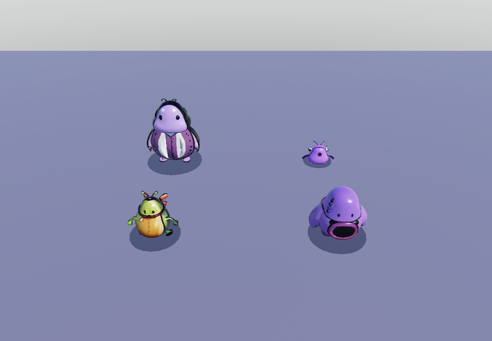
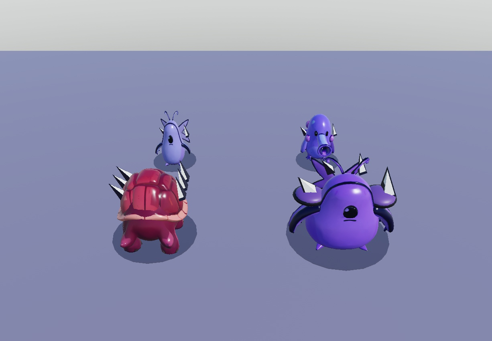
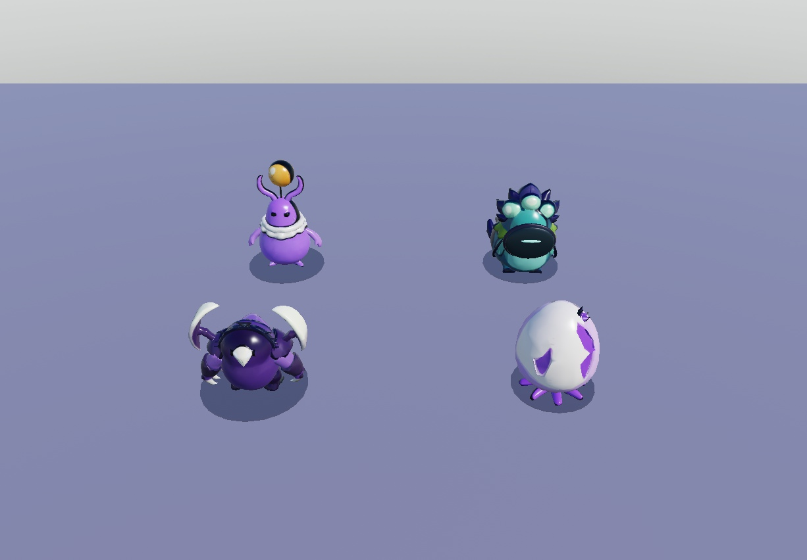
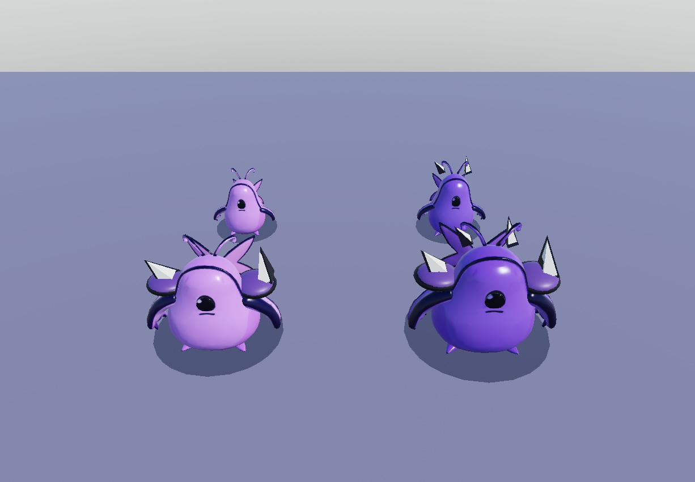

# Gegner-Redesign – normale Gegner

Stand: 01.11.2026. Der Owner hat den kompakten violetten Shadeling mit schwarzen Konturen als Stilrichtung bestätigt. Größere Gegner sollen innerhalb dieses Stils zusätzliche Formen und Details erhalten. Referenz: [Brotato-Gegnerübersicht des Owners](https://justgameguides.com/game/brotato/enemies).

## Umfang

| Gegner | Ausarbeitung | Teile, inklusive Schatten/Vorwarnung | Mesh-Dreiecke |
| --- | --- | ---: | ---: |
| Shadeling | Kompakter Körper, schwarzes Auge, Konturen, Rückenflossen, getrennt bewegliche Arme | 5 | 2.984 |
| Brute | Breiterer und schwererer Körper derselben Spezies, vergrößerte Arme/Flossen, eingefasste Schulterplatten und Stacheln | 13 | 2.984 plus primitive Platten/Stacheln |
| Spitter | Breites Schussmaul, Giftdrüsen, Kiemen/Flossen, pendelnde Arme | 4 | 3.498 |
| Charger | Segmentierter Hornpanzer, tiefer Kopf, vier getrennte Beine und erhaltene Sturmvorwarnung | 9 | 4.322 |

Die 17 normalen Gegnertypen einschließlich der beiden Abyss-Varianten und ihrer Gloom-Elites verwenden den bestätigten Stil. Der erntbare Baum bleibt unverändert. Die zwei Bosse und acht Champions sind der nächste Durchgang.

## Zweite Serie: weitere 13 Typen

| Gegner | Ausarbeitung | Teile | Mesh-Dreiecke |
| --- | --- | ---: | ---: |
| Splitter | Breiter gegliederter Körper, helle Panzerstreifen, dunkle Kopfkappe | 4 | 3.990 |
| Splitling | Gedrungener kleiner Verwandter mit seitlichen Schalenfragmenten | 8 | 2.636 |
| Looter | Grüner flinker Träger mit ockerfarbenem Tragbeutel und Fühlern | 3 | 3.392 |
| Gobbler | Breiter Körper, getrennte Gliedmaßen, große dunkle Saugöffnung | 9 | 4.024 |
| Stalker | Schmale hohe Gestalt und zusätzliche nach hinten gerichtete Flossen | 9 | 2.984 |
| Skulker | Längerer engerer Schusskanal und seitliche Flossen | 8 | 3.498 |
| Thornback | Roter schwerer Panzer mit sechs eingefassten Rückenstacheln | 19 | 3.904 |
| Herald | Helle Halsplatten und amberfarbene Signalkugel zwischen Fühlern | 5 | 3.484 |
| Mender | Türkise Drüsen, dunkler Blattpanzer und schlichte Gesichtsplatte mit Sehschlitz | 8 | 3.500 |
| Brood Egg | Aufgebrochene helle Eischale mit violettem Kern und organischem Sockel | 4 | 2.500 |
| Reaper | Segmentierte Sichelarme, Rückenpanzer, kleinere Kopfklinge und getrennte Füße | 10 | 4.152 |
| Abyss Shadeling | Dunklere Färbung und zusätzliche Kopfstacheln | 9 | 2.984 |
| Abyss Brute | Größerer schwerer Körper mit zusätzlichen Kopfstacheln | 17 | 2.984 |

Teile enthalten Schatten und gegebenenfalls Warnfläche. Mesh-Dreiecke enthalten keine ergänzenden primitiven Platten/Stacheln. Am meisten Teile hat Thornback: 19 normal, 24 als Gloom-Elite, innerhalb der Limits von 20/25.

## Einbindung

- `MeshCatalog.luau` enthält Mesh-/Textur-IDs, bearbeitete Proportionen, Positionen und Gelenkpunkte. Die Modelle werden ausdrücklich über ihre eigene Gegner-ID ausgewählt; andere Arten erben nicht versehentlich einen ungeprüften Look.
- `Models.luau` baut gepoolte, verankerte Parts mit `SpecialMesh`. Größen folgen weiterhin dem vorhandenen Kollisionsradius. Animationen nutzen die vorhandenen Gelenke und `BulkMoveTo`; es gibt keine neue Gegner-KI, Humanoids, Remotes oder Balancewerte.
- `EnemyRenderer.init` lädt die Artwork-Inhalte im Hintergrund während der Lobby vor. `PreloadAsync` bekommt Instanzen, damit Geometrie als Mesh und nicht als Bild angefragt wird.
- Treffer blitzen weiß; dafür wird die Textur kurz entfernt und danach wiederhergestellt. Brennen, Verlangsamen und Buffs färben auch die Texturen. Armored ändert die Panzerfarbe und das Material, Swift und Summoning bleiben erhalten. Pool-Reset stellt die Texturen wieder her.
- Die bisherigen Limits bleiben bestehen: maximal 20 Teile normal, 25 als Elite. Kleine Flossen/Horn-Einsätze können durch den vorhandenen Detailmodus ausgeblendet werden; wesentliche Körper und Gesichter bleiben erhalten.

## Herkunft

Die Meshes wurden über den Roblox-Studio-Generator für dieses Projekt erstellt, anschließend proportional bearbeitet und an das vorhandene Rig angepasst. Es wurden keine Bilddateien oder Spiel-Assets von Brotato ins Repo kopiert. Die Roblox-Inhalte sind bereits hochgeladen; das Spiel selbst wurde nicht veröffentlicht.

| Ausgangsmodell | Roblox-Modell-ID | Weitere Bearbeitung |
| --- | --- | --- |
| Bestätigter Shadeling | `129131458877749` | Arme getrennt, Gelenke gesetzt; Basis für den manuell breiter ausgearbeiteten Brute |
| Spitter | `105000492232715` | Schussmaul gekürzt und verbreitert |
| Charger | `113557863847473` | Körper und vier Beine für den Gang getrennt |

Weitere ursprüngliche Roblox-Modell-IDs: Splitter `99658228849027`, Looter `131708596826531`, Herald `71366442585330`, Mender `129319117741511`, Reaper `121159822400279`, Gobbler `131547563447190`, Brood Egg `96453350435303`. Reaper und Gobbler wurden weiter segmentiert. Looter behält das vollständige Körpermesh mit eigener Wippbewegung, weil die Segmentierung die saubere Darstellung des Tragbeutels verschlechterte. Die Mender-Texturversuche wurden verworfen; das Originalmesh mit passender Originaltextur und einer manuell aufgebauten dunklen Gesichtsplatte wird verwendet. Ein Baum-Prototyp gehört nicht zu diesem Gegner-Auftrag und ist nicht eingebunden.

Die endgültigen einzelnen Mesh- und Textur-IDs stehen vollständig im Katalog. Die Dreieckszahlen wurden in Studio mit `EditableMesh:GetFaces()` nach der Segmentierung gemessen. Die realistischeren frühen Entwürfe gehören nicht zur ausgelieferten Serie. Der separate neue Brute-Generierungsversuch wurde von Roblox mit `Moderation failed` abgelehnt; der Brute wurde deshalb aus dem bestätigten Shadeling weitergebaut.

## Geprüft und offen

- 69 Testdateien: **728 Tests erfolgreich**, darunter Budget, Gelenkzuordnung, Mesh-Proportionen, Textur-/Status-Reset und Armored nach Treffern.
- StyLua, Selene (0 Fehler; 11 vorhandene Warnungen außerhalb dieses Umbaus) und Rojo-Build erfolgreich.
- Studio Edit: Formen einzeln, Vergleich mit den alten Modellen, Treffer-/Statusfarben und Modellreihe geprüft.
- Studio Play, Client: alle 74 unterschiedlichen Mesh-/Texturinhalte erfolgreich geladen. 140 animierte Modelle über den echten `Models.pose`-/`BulkMoveTo`-Pfad bewegt, 1.247 sichtbare Teile pro Pose, im Detailmodus Low 1.019. 32 Warnflächen in der Mischung erscheinen und verschwinden beim Reset korrekt, einschließlich Schnitt- und Unterstützungsringen. Trefferblitz, Textur-Reset und Armored wurden für die gesamte Mischung geprüft.
- Aktuellen `main` bis `9833229` aufgenommen: neue Kamera-/Capture-Schnittstelle und Spielablauf bleiben erhalten. Gesamte Testsuite und Build danach erneut geprüft; die native Studio-Prüfung galt den Modellmodulen. Der strengere API-Mock enthält jetzt auch `CornerWedgePart` und `ContentProvider`.
- Der 140-Modell-Test ist ein **Funktionstest, kein FPS-Benchmark**. Ein vollständiger Run, 2 Clients, Handy-FPS/Texture-Memory und das Laden im veröffentlichten Run-Place wurden nicht geprüft. Die vorhandene Warnung zu Asset `203785492` stammt nicht aus diesem Artwork-Katalog.

## In Studio ansehen

1. Branch synchronisieren und Studio im Bearbeitungsmodus öffnen.
2. Im Werkzeug oben `page` auf 1–5 setzen (1: erste vier, 2: Splitter/Beute, 3: Jäger, 4: Unterstützer/Reaper, 5: Abyss-Vergleich). Für die isolierte Modellreihe den Inhalt von `tools/PreviewEnemyArt.luau` in der Studio-Befehlsleiste ausführen. Das Werkzeug klont die aktuellen Module neu, damit ältere `require`-Caches keine alten Modelle zeigen.
3. Dasselbe Werkzeug erneut ausführen: Die temporäre Bühne verschwindet und die ursprüngliche Kamera wird wiederhergestellt. **Die Bühne vor dem Veröffentlichen entfernen.**
4. Im normalen Spiel die ersten Wellen und eine Charger-Sturmvorwarnung ansehen; zusätzlich Elites mit Swift, Armored und Summoning prüfen. Die Bosse und Champions sind die nächste Ausarbeitungsserie.
