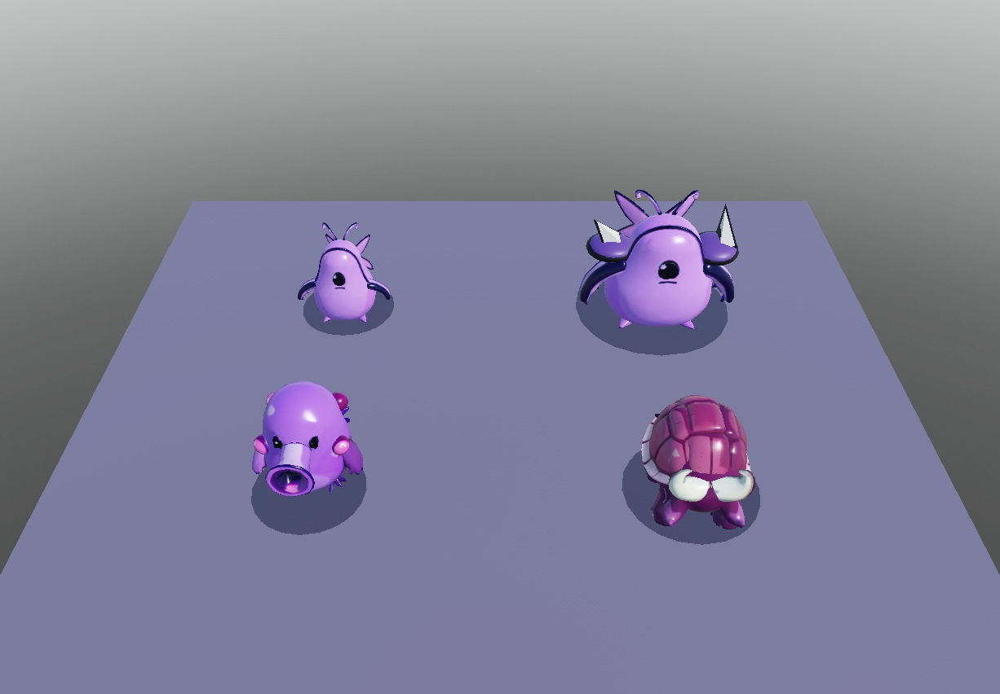

# Gegner-Redesign – erste vier Modelle

Stand: 31.10.2026. Der Owner hat den kompakten violetten Shadeling mit schwarzen Konturen als Stilrichtung bestätigt. Größere Gegner sollen innerhalb dieses Stils zusätzliche Formen und Details erhalten. Referenz: [Brotato-Gegnerübersicht des Owners](https://justgameguides.com/game/brotato/enemies).

## Umfang

| Gegner | Ausarbeitung | Teile, inklusive Schatten/Vorwarnung | Mesh-Dreiecke |
| --- | --- | ---: | ---: |
| Shadeling | Kompakter Körper, schwarzes Auge, Konturen, Rückenflossen, getrennt bewegliche Arme | 5 | 2.984 |
| Brute | Breiterer und schwererer Körper derselben Spezies, vergrößerte Arme/Flossen, eingefasste Schulterplatten und Stacheln | 13 | 2.984 plus primitive Platten/Stacheln |
| Spitter | Breites Schussmaul, Giftdrüsen, Kiemen/Flossen, pendelnde Arme | 4 | 3.498 |
| Charger | Segmentierter Hornpanzer, tiefer Kopf, vier getrennte Beine und erhaltene Sturmvorwarnung | 9 | 4.322 |

Die entsprechenden Gloom-Elites verwenden ebenfalls die neuen Modelle, mit Goldtönung, Krone und ihren bisherigen Eigenschaften. Abyss-Varianten, weitere B9-Arten, Splitter/Splitling, Looter, Bosse und Champions sind **noch nicht neu ausgearbeitet**. Sie behalten ihre bisherigen Modelle; diese erste Serie erklärt nicht das gesamte Gegner-Redesign für abgeschlossen.

## Einbindung

- `MeshCatalog.luau` enthält Mesh-/Textur-IDs, bearbeitete Proportionen, Positionen und Gelenkpunkte. Die vier Modelle werden ausdrücklich über ihre eigene Gegner-ID ausgewählt; andere Arten erben nicht versehentlich einen ungeprüften Look.
- `Models.luau` baut gepoolte, verankerte Parts mit `SpecialMesh`. Größen folgen weiterhin dem vorhandenen Kollisionsradius. Animationen nutzen die vorhandenen Gelenke und `BulkMoveTo`; es gibt keine neue Gegner-KI, Humanoids, Remotes oder Balancewerte.
- `EnemyRenderer.init` lädt die Artwork-Inhalte im Hintergrund während der Lobby vor. `PreloadAsync` bekommt Instanzen, damit Geometrie als Mesh und nicht als Bild angefragt wird.
- Treffer blitzen weiß; dafür wird die Textur kurz entfernt und danach wiederhergestellt. Brennen, Verlangsamen und Buffs färben auch die Texturen. Armored ändert die Panzerfarbe und das Material, Swift und Summoning bleiben erhalten. Pool-Reset stellt die Texturen wieder her.
- Die bisherigen Limits bleiben bestehen: maximal 20 Teile normal, 25 als Elite. Kleine Flossen/Horn-Einsätze können durch den vorhandenen Detailmodus ausgeblendet werden; wesentliche Körper und Gesichter bleiben erhalten.

## Herkunft

Die Meshes wurden über den Roblox-Studio-Generator für dieses Projekt erstellt, anschließend proportional bearbeitet und an das vorhandene Rig angepasst. Es wurden keine Bilddateien oder Spiel-Assets von Brotato ins Repo kopiert. Die Roblox-Inhalte sind bereits hochgeladen; das Spiel selbst wurde nicht veröffentlicht.

| Ausgangsmodell | Roblox-Modell-ID | Weitere Bearbeitung |
| --- | --- | --- |
| Bestätigter Shadeling | `129131458877749` | Arme getrennt, Gelenke gesetzt; Basis für den manuell breiter ausgearbeiteten Brute |
| Spitter | `105000492232715` | Schussmaul gekürzt und verbreitert |
| Charger | `113557863847473` | Körper und vier Beine für den Gang getrennt |

Die endgültigen einzelnen Mesh- und Textur-IDs stehen vollständig im Katalog. Die Dreieckszahlen wurden in Studio mit `EditableMesh:GetFaces()` nach der Segmentierung gemessen. Die realistischeren frühen Entwürfe gehören nicht zur ausgelieferten Serie. Der separate neue Brute-Generierungsversuch wurde von Roblox mit `Moderation failed` abgelehnt; der Brute wurde deshalb aus dem bestätigten Shadeling weitergebaut.

## Geprüft und offen

- 67 Testdateien: **708 Tests erfolgreich**, darunter Budget, Gelenkzuordnung, Mesh-Proportionen, Textur-/Status-Reset und Armored nach Treffern.
- StyLua, Selene (0 Fehler; 11 vorhandene Warnungen außerhalb dieses Umbaus) und Rojo-Build erfolgreich.
- Studio Edit: Formen einzeln, Vergleich mit den alten Modellen, Treffer-/Statusfarben und Modellreihe geprüft.
- Studio Play, Client: alle 23 unterschiedlichen Mesh-/Texturinhalte erfolgreich geladen. 140 animierte Modelle über den echten `Models.pose`-/`BulkMoveTo`-Pfad bewegt, 1.050 sichtbare Teile pro Pose. Charger-Vorwarnung erscheint und verschwindet beim Reset korrekt.
- Der 140-Modell-Test ist ein **Funktionstest, kein FPS-Benchmark**. Ein vollständiger Run, 2 Clients, Handy-FPS/Texture-Memory und das Laden im veröffentlichten Run-Place wurden nicht geprüft. Die vorhandene Warnung zu Asset `203785492` stammt nicht aus diesem Artwork-Katalog.

## In Studio ansehen

1. Branch synchronisieren und Studio im Bearbeitungsmodus öffnen.
2. Für die isolierte Modellreihe den Inhalt von `tools/PreviewEnemyArt.luau` in der Studio-Befehlsleiste ausführen. Das Werkzeug klont die aktuellen Module neu, damit ältere `require`-Caches keine alten Modelle zeigen.
3. Dasselbe Werkzeug erneut ausführen: Die temporäre Bühne verschwindet und die ursprüngliche Kamera wird wiederhergestellt. **Die Bühne vor dem Veröffentlichen entfernen.**
4. Im normalen Spiel die ersten Wellen und eine Charger-Sturmvorwarnung ansehen; zusätzlich Elites mit Swift, Armored und Summoning prüfen. Die übrigen Arten sind die nächste Ausarbeitungsserie.
