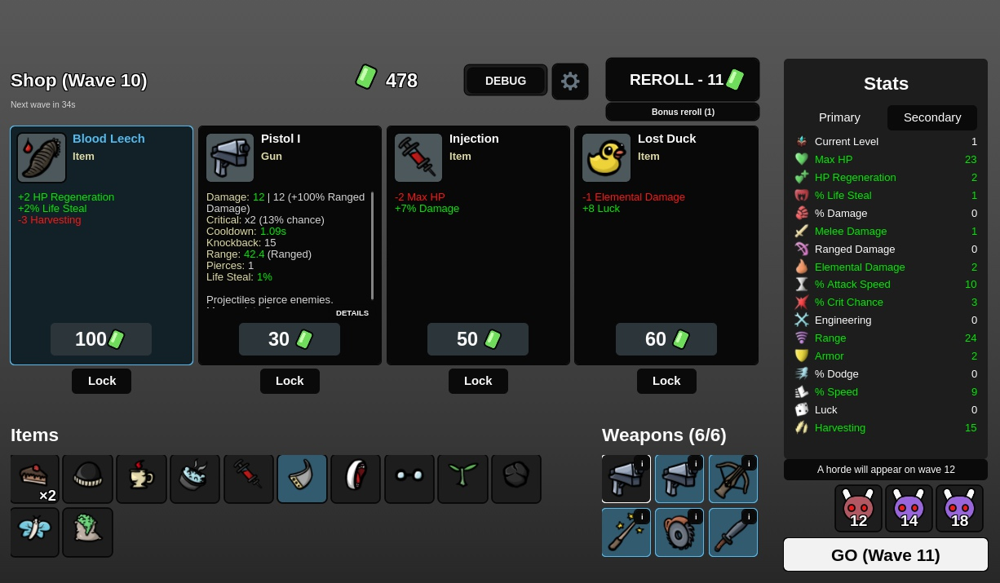
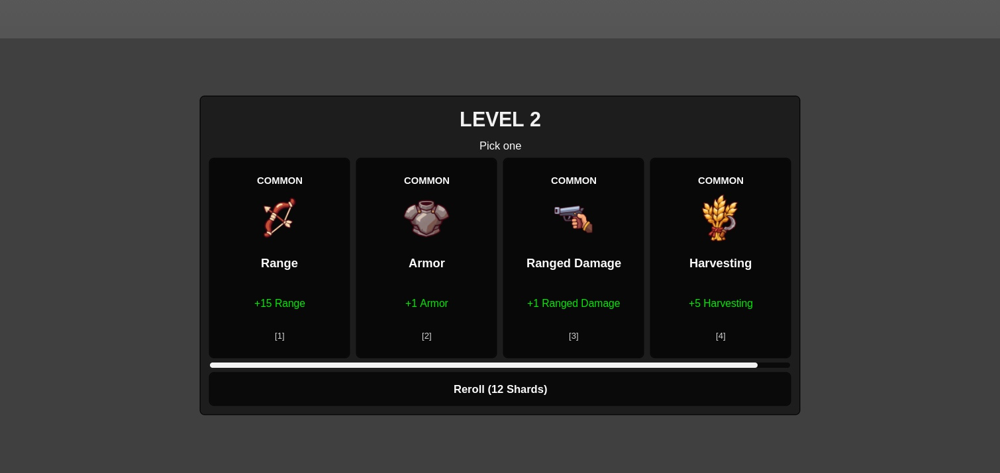

# Freigegebenes Brotato-UI

Owner-Auftrag vom 06.11.2026; Vorschau zuerst gezeigt und mit „genau so“ bestaetigt. Branch: `wp-21j-brotato-ui`.

## Ergebnis

Der Shop folgt der bestaetigten Komposition: vier hohe Angebote mit kleinen Illustrationen, sichtbaren Waffenwerten und Preisen, separate Lock-Knoepfe, Items unten links, Waffen daneben und eine eigene rechte Wertespalte. Reroll steht oben, GO mit der naechsten Welle unten rechts. Die Wellenleiste zeigt die tatsaechlich vom Server geplanten Elite-/Horden-Wellen; bei Gefahr 0 erfindet sie keine Elites.

Graue Flaechen, fast schwarze Knoepfe, Arial, Seltenheitsfarben, rote HP und gruene XP ersetzen die vorherige warme Palette und die verspielte Schrift. Lobby, Level-ups und gemeinsame Dialoge verwenden dieselbe Gestaltung. Kleine Displays behalten ihr scrollbares Layout, feste Hauptaktionen und STATS/SHOP. Bereits vorhandene Online-Koop-, Bonus-Reroll- und Detailfunktionen bleiben erreichbar.

Die Vorschau unter `images/ui-approved-shop.png` ist ein KI-Entwurf mit Beispielwerten. Die folgenden Bilder stammen aus Roblox Studio. Der Shop-Screenshot zeigt bereits die inzwischen gemergten Originalwaffen/-Items/-Stat-Symbole; der Level-up-Screenshot entstand vor deren Merge.

## Umsetzung und Grenzen

`UI/ShopComposition` gestaltet die vorhandenen Kontrollen; Kauf, Sperre, Reroll, Verkauf, Verschmelzen und Bereitschaft bleiben in `ShopController` und auf den vorhandenen Serverwegen. `UI/ShopLayout` haelt Shop und Werte geometrisch zusammen. `UI/OfferText` ist eine reine Anzeigevorschau aus Config und der zuletzt erhaltenen Stat-Tabelle, keine Quelle fuer Kampfschaden. Ihre Hauptwerte werden fuer alle Waffenstufen und mehrere positive/negative Stat-Tabellen gegen `WeaponService/WeaponStats.compute` verglichen.

`StatsController.Changed` ist ein neues lokales Signal fuer die Aktualisierung der Vorschau. Es gibt keine neuen Remotes und keine Aenderung an Profilen, Preisen oder Balancing. Die Konfliktloesung mit dem aktuellen main erhaelt Dezimalpraezision, dynamisches Ausweichlimit, Item-Mindestcooldown, Level-Skalierung und Waffen ohne Abprallen.

Die bewussten UI-Textaenderungen sind auch in den bestehenden Smoke-Erwartungen nachvollzogen: Sekunden statt mm:ss, Zahlen plus Shard-Symbol statt ausgeschriebenem Shards-Text, kostenloser Neuwurf als REROLL - 0. Die Kauf-/Sperr-/Verkaufs-/Merge-Pruefungen bleiben bestehen.

## Pruefung

- Voller Vergleich gegen main `9a26036`: 956 bestanden / 31 fehlgeschlagen in 78 Specs; UI: 960 / dieselben 31 in 79 Specs. Jede Spec einzeln mit Lune ausgefuehrt. Bericht: `ui-validation.json`.
- Vier neue UI-Tests bestehen. Sie pruefen die Vorschauwerte, Desktop-/Portrait-/Querformatwechsel sowie echte Serverreaktionen auf Kaufen, Sperren, Reroll und GO. Der 3D-Waffenrenderer wird ausschliesslich in dieser gezielten UI-Spec ausgeschaltet, weil dessen vorhandene Mock-Probleme in den anderen Specs separat sichtbar bleiben.
- Ein absichtlich invertierter No-Bounce-Zweig laesst den Vorschautest fehlschlagen; danach wurde die Originaldatei bytegleich wiederhergestellt und der Lauf bestand wieder.
- StyLua, Rojo-Build und `git diff --check` erfolgreich. Selene: 0 Fehler, 11 bestehende Warnungen. Rust/Cargo ist hier nicht installiert; verwendet wurde der bereits vorhandene Lune-Runner.
- Fuer die native Solo-Sichtpruefung wurde eine separate lokale Testdatei benutzt. Alle 352 Produktionsmodule waren vor dem Lauf mit dem UI-Checkout auf Basis des aufgenommenen main bytegleich. Native Kaufprobe: 478 -> 378 Shards, danach SOLD; Lock probeweise auf LOCKED. Im vorherigen Solo-Stand ausserdem Neuwurf, Verkauf, Merge von II nach III, GO, Level-up und Settings.
- Zur laengeren Bedienpruefung war in einer aelteren isolierten Testdatei die Shop-Frist zeitweise auf 600 s gesetzt. Der abschliessende Shop-Screenshot verwendet die unveraenderte Produktionsfrist von 40 s. Diese Testeinrichtung wurde nicht eingecheckt.
- Der spaetere main `f73e05b` ersetzt nur das neutrale Augen-Itembild samt Zuordnung und Berichten und wurde aufgenommen. Danach UiShop (4), ItemSprites (5) und PrimaryStatArt (6) erneut gruen, insgesamt 15/0. Die offenen, abweichenden Main-Lobby-Quellen des Owners wurden nicht ueberschrieben. Keine Experience veroeffentlicht oder gemerged.

**Noch offen:** echter Zwei-Client-Lauf, physisches Handy und native Handy-Emulation auf dem finalen Branch. Programmatische Groessenwechsel ersetzen keine Touch-/Geraete-Abnahme. Bereits vorhandene Studio-Warnungen zu Asset `203785492` und zwei noch generierten Charakter-Assets wurden nicht als UI-Fehler behandelt.

## Owner-Test

1. Den Branch per ZIP holen und mit Rojo in der Test-Experience laden. Play starten, Charakter und Startwaffe wechseln. Im Run rote HP, gruene XP und die Wellenzeit ansehen.
2. Ueber Debug eine Welle beenden. Falls Level-ups erscheinen, eine Karte waehlen. Im Shop ein Item kaufen, ein anderes Angebot sperren und neu wuerfeln. Die Sperre muss bleiben; bezahlte Shards muessen korrekt abgezogen werden. Zwei gleiche Waffen verschmelzen und eine andere verkaufen. GO startet die naechste Welle.
3. Mit zwei Clients denselben Ablauf pruefen. Danach Handy-Portrait und -Querformat: scrollen, STATS/SHOP wechseln, Details und Einstellungen oeffnen, GO erreichen. Es darf kein abgeschnittener Hauptknopf oder verdeckter Preis entstehen.

## Referenzen

- [Brotato-Shop-Referenz mit Screenshots](https://steamcommunity.com/sharedfiles/filedetails/?id=2896126855)
- [Brotato-Wiki: Shop](https://brotato.wiki.spellsandguns.com/Shop)
- [Offizielle Steam-Seite](https://store.steampowered.com/app/1942280/Brotato/)
