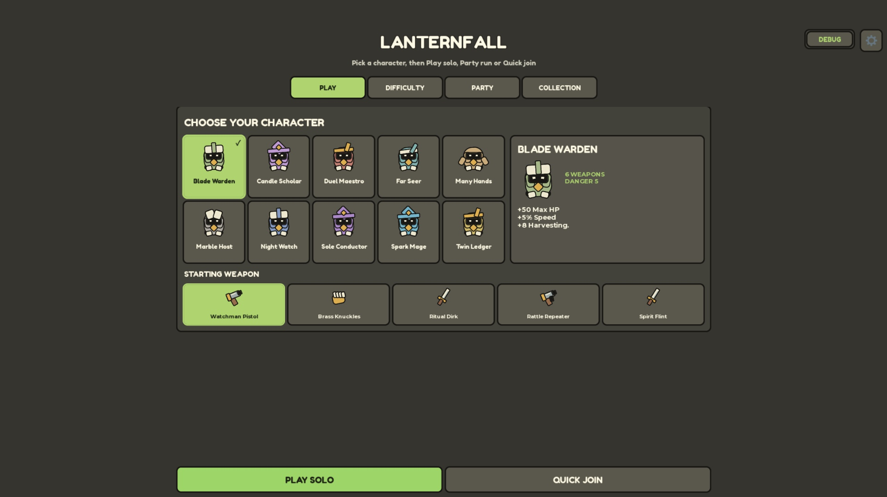
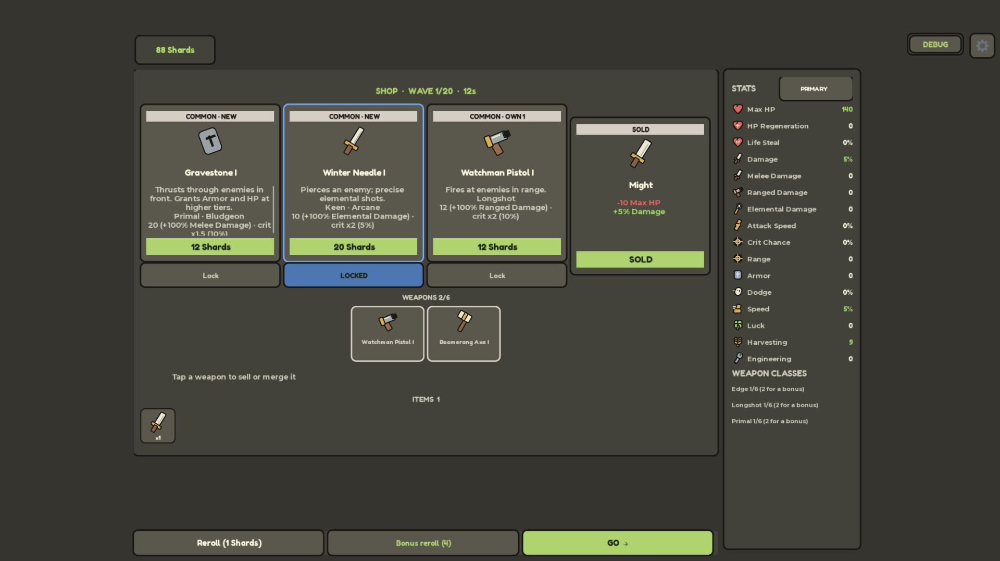
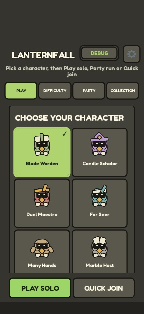
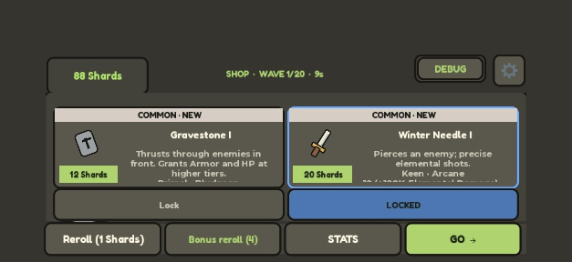

# UI-Rework im Brotato-Stil

Owner-Auftrag vom 02.11.2026. Branch: `codex/brotato-ui-rework`, Basis `main` / `9833229`.

## Ergebnis

Das neue UI ersetzt die textlastige Darstellung durch große Bildkarten, kräftige dunkle Konturen, warme Steinfarben, helle Schrift und grüne Hauptaktionen. Charaktere, Namen und Zeichnungen bleiben Lanternfalls eigene Inhalte.

- **Lobby:** zehn Charakterporträts mit sichtbarer Auswahl, eigenem Detailbereich, Startwaffenbildern, Schloss und Freischaltpreis. Auswahlregeln und kostenlose Freischaltbedingungen bleiben per Tooltip erreichbar. Play/Quick Join/Ready bleiben außerhalb des Scrollbereichs sichtbar. Auf kurzen Displays werden Überschrift und Karten kompakter.
- **Shop:** vier bebilderte Angebote, farbige Seltenheit, grüne/rote Effekte, eigener Preisbereich und separate Sperrknöpfe. Darunter Waffen mit Verkaufs-/Kombinationsauswahl sowie das vollständige Item-Inventar mit Mengen und Tooltips. Die Aktionen bleiben beim Scrollen sichtbar. Desktop zeigt die Werte direkt daneben; Portrait zeigt zwei Karten pro Reihe, kurzes Querformat zwei kompakte Karten und eine einzelne Aktionszeile.
- **HUD:** HP und XP gemeinsam links oben, Zeit und Welle in der Mitte, Build auf Abruf. Die Teamliste entfällt solo. Der Dashknopf verschwindet zwischen Wellen und außerhalb des Runs.
- **Dialoge:** Level-ups und Kisten haben gezeichnete Symbole. Die gemeinsame Dialoghülle zentriert kurze Fenster, lässt lange Inhalte scrollen und hält Schließen erreichbar. Offene Dialoge liegen vor Debug und anderen Spielanzeigen. Settings, Collection und Ergebnisse übernehmen die gemeinsame Gestaltung.

`UI/Icons.luau` zeichnet Originalgrafiken aus Roblox-GUI-Formen. Charaktere haben eigene Porträts; Waffen teilen sich passende Grundformen mit Varianten. Item-Symbole zeigen die positive Wertekategorie, nicht 114 separate Item-Illustrationen. Unveränderte Illustrationen werden bei Preis-/Statusmeldungen wiederverwendet.

## Native Vorschauen

Die Bilder stammen aus Roblox Studio, nicht aus einem Mockup. Der Debugknopf ist nur für Administratoren sichtbar.

## Prüfung

- **69 Specs / 724 Tests bestanden**, einschließlich Kauf, Sperren, Reroll, Verkauf, Kombination, Level-up-Auswahl, Itemmengen, Freischaltungen, Einladungen und Mehrspieler-Abläufen im Mock.
- `UiRedesign.spec.luau`: 10 Tests; zusätzlich Prüfung von stabilen Illustrationen bei Preisänderungen, Itemmengen, festem Lobby-Footer, Querformat, Dash-Sichtbarkeit und Dialogreihenfolge. Die vorhandenen Freischalt-Tests lesen die neuen Namen-/Preislabels und prüfen den Anforderungstext im Tooltip.
- StyLua, `git diff --check` und Rojo-Build erfolgreich. Selene: **0 Fehler, 11 vorhandene Stilwarnungen**. Der API-Download ist nicht erreichbar; Selene verwendet seinen vorhandenen Roblox-Cache.
- Studio: Lobby, HUD, Shop, Level-up, Settings und Ergebnisse angesehen; HD-720/1080 sowie iPhone 17 Pro in Portrait/Querformat geprüft. Effektive nutzbare Größen hängen von den Roblox-Inset-Flächen ab; auf dem iPhone wurden u. a. 401 × 720 und 750 × 323 GUI-Pixel geprüft.
- Native Bedienprobe: Play solo, Itemkauf (108 → 88 Shards), sichtbarer Itemzähler, Angebotssperre, STATS mit ausgeblendetem Shop-Footer, Level-up-Tastenauswahl und Ergebnisdialog. Die bestehenden Serverprüfungen wurden verwendet.
- Kein neuer UI-Laufzeitfehler. Bestehende Warnungen zu Asset `203785492` und nicht eingetragenen Badge-IDs bleiben außerhalb dieses Auftrags. Ein erster Champion-Testlauf war zufallsabhängig rot; der gezielte Wiederholungslauf und der abschließende Gesamtlauf waren grün. Kein Gegner-/Servercode geändert.
- Produktionsmodule im geöffneten Studio synchronisiert, Geräte-Simulation zurückgesetzt und Play beendet. Die bereits vorhandenen Gegner-Modelle wurden nicht überschrieben.

**Noch nicht geprüft:** echter Zwei-Client-Studio-Lauf, physisches Handy und veröffentlichter Run-Place. Der Simulator ist kein Geräte-Performance-Test. Das Spiel wurde nicht veröffentlicht oder gemerged.

## Owner-Abnahme

1. In Studio **Play** starten. Charakter und Startwaffe wechseln; Porträt, Auswahlmarkierung und Detailtexte prüfen. **Play solo** bleibt beim Scrollen erreichbar.
2. Im Run HP/XP und Zeit ansehen. Über **Debug → Skip wave** zum Shop wechseln. Ein Angebot kaufen und ein anderes sperren; im Waffeninventar Verkauf/Kombination prüfen.
3. Im Device Emulator ein Handy auswählen, zwischen Portrait und Querformat wechseln. Shop scrollen, **STATS → SHOP** testen und Settings öffnen/schließen.

## Übergabe und Git

Der ausdrückliche UI-Auftrag umfasst die UI-Dateien und die ansonsten Strang A zugeordneten Anzeige-/Eingabecontroller. Server, Remotes, Balance, gespeicherte Profile und Kaufbestätigungen wurden nicht geändert.

PR #56 für Gegner-Art ist weiterhin offen. `docs/PARALLEL.md`, Abschnitt 4, erlaubt „Pro Strang höchstens ein offener PR“. Deshalb liegt dieses vollständige Rework auf einem eigenen Branch; es wird kein zweiter PR eröffnet. Der vorbereitete PR-Text steht in `docs/UI-BROTATO-PR.md`. Nach Abschluss von #56 den UI-Branch mit main abgleichen und den UI-PR öffnen; ein Merge braucht den Owner-Auftrag.
