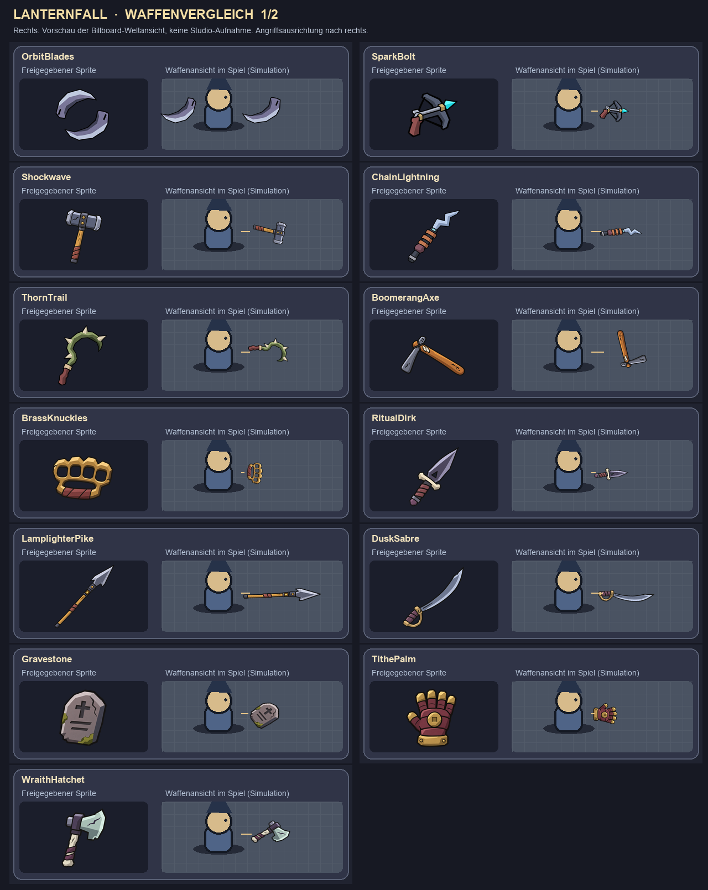
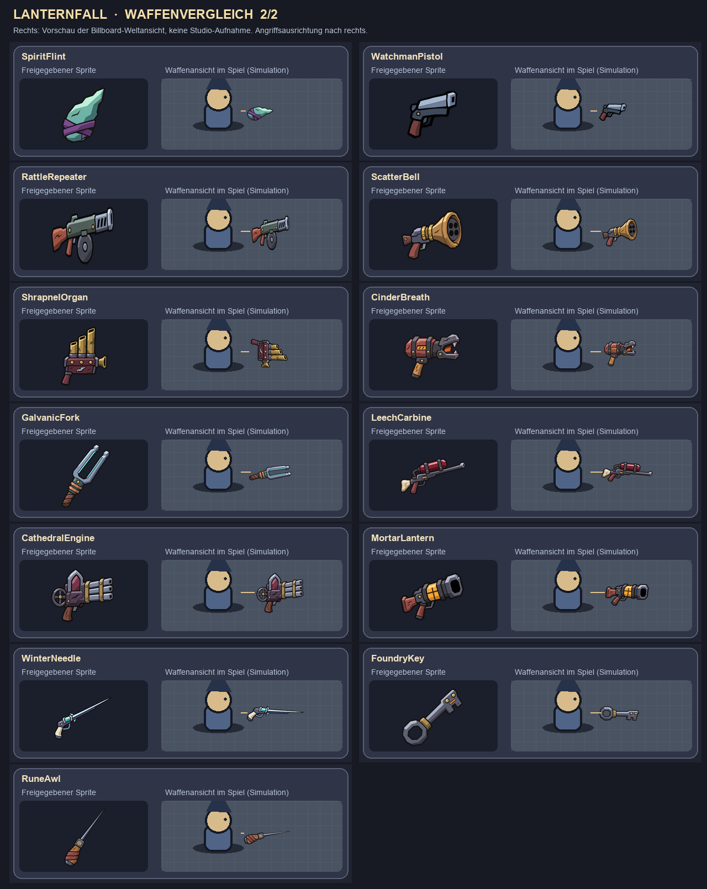

# Weapon sprite comparison (package 21e)

The left side of each card is the owner-approved source sprite from `assets/weapons/final/`. The right side simulates the world-space BillboardGui weapon beside a simple character, facing right. This is a size and orientation review aid, not a Roblox Studio capture. In the run, each sprite faces the current attack direction.

`BrassKnuckles` and other small equipment use smaller presentation sizes and sit closer to the character. The two `OrbitBlades` sprites are separated from the approved pair artwork and orbit at the server's blade positions.
